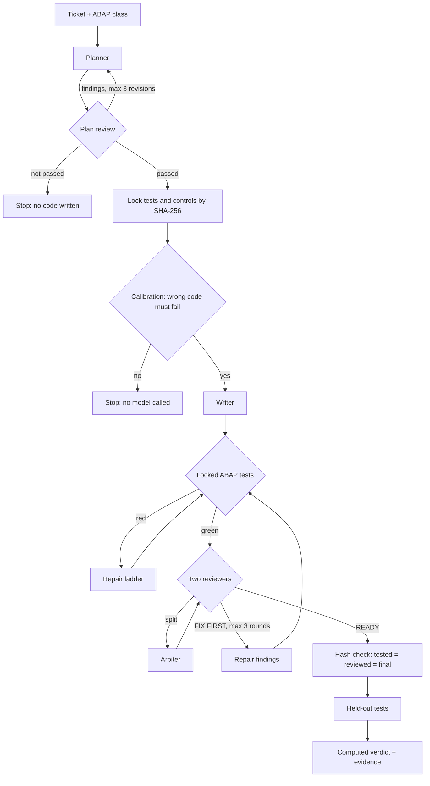
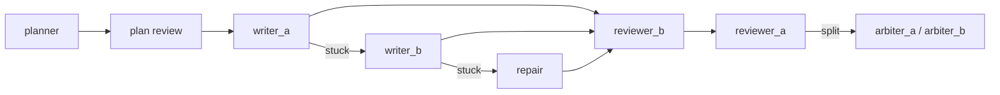
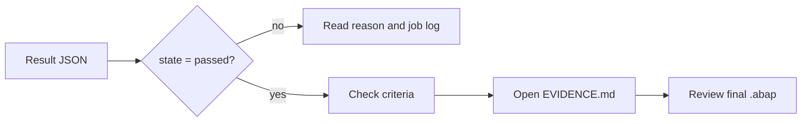

# Satvik Loop for SAP/ABAP

**Automated ABAP coding with locked tests, held-out tests, a computed verdict and a full evidence trail. Runs ABAP offline; no SAP system needed.**

## What it is

| | |
|---|---|
| Input | A ticket and an ABAP class |
| Output | A tested, reviewed class plus an evidence folder |
| ABAP execution | abaplint transpiler to JavaScript, under `node --permission` |
| Models | One role, one roster entry: OpenRouter, Claude CLI or Codex CLI |
| Decision | Computed from recorded files, not stated by a model |

## Results at a glance

| Metric | Result |
|---|---:|
| Hard benchmark tasks solved | **10 / 10** |
| Solved on the first valid attempt | **9 / 10** |
| Unit tests passing on an independent rerun | **66 / 66** |
| Held-out tests passing | **30 / 30** |
| Calibration passed before coding | **10 / 10** |
| Evidence manifests and hash chains verified | **10 / 10** |
| Model cost, writing to review, plus planner | **about $0.17** at list prices; plan review not recorded |

**Conditions**

- **Offline:** transpiler and SQLite. No SAP system, ABAP Unit on SAP or ATC.
- **One model family:** Claude Haiku 5.5 wrote and reviewed, so this is same-model review. The strict verdict, which requires independent review, stays `solved: false`.
- **One rerun:** task 129 failed plan review, then passed on a rerun after the plan-revision limit changed from 1 to 3. The rerun used no extra revision.
- **Starting point:** each task supplied the public class signature with empty method bodies.
- **Held-out strength:** 14 of 30 held-out tests fail on the empty class. The other 16 act as regression checks.
- **Syntax:** the bench gate checks parse errors. A stricter abaplint check afterwards: 9 classes clean, 1 finding from a class missing in the offline library.

## Pipeline

## Solved problems

Source: [LLM-Benchmark-ABAP-Code-Generation](https://github.com/timkoehne/LLM-Benchmark-ABAP-Code-Generation). Tasks were selected by a fixed rule before the runs: the lowest published success rates among eligible tasks.

| Task | Asks for | Category | Tests passed | Held-out passed | Published success* |
|---|---|---|---:|---:|---:|
| `104` | Sorted numbers with no even digit | Algorithm | 4/4 | 2/2 | 1.7% |
| `20` | Closest pair of numbers | Algorithm | 3/3 | 1/1 | 1.7% |
| `129` | Minimum path through a grid | Algorithm | 11/11 | 5/5 | 5.0% |
| `22` | Keep only integer values | Data handling | 3/3 | 1/1 | 5.0% |
| `0` | Any two numbers closer than a threshold | Algorithm | 7/7 | 3/3 | 10.0% |
| `erp_010` | Customer search by partial pattern | Database | 8/8 | 4/4 | 1.1% |
| `erp_004` | Validate an employee hierarchy | Database | 12/12 | 6/6 | 4.2% |
| `erp_005` | Critical path of a production process | Database | 5/5 | 2/2 | 6.8% |
| `erp_006` | Calculate stock from transactions | Database | 6/6 | 3/3 | 18.9% |
| `erp_000` | Find the CEO in an organization | Database | 7/7 | 3/3 | 20.5% |

\* Top-6 models for general tasks, all models for database tasks. Those runs used real SAP and had to design the class, so this shows task difficulty and is not a head-to-head comparison.

**Real-repository benches, with different model families writing and reviewing**

| Bench | Problem | Solved runs | Held-out on solved runs |
|---|---|---:|---:|
| D | abapGit PR 7922: form feed in staged patch | 3 of 3 | 8/8 each |
| F | abapGit PR 7118: HTML indentation | 2 of 3 | 11/11 each |
| C | abap2xlsx PR 838: formula shifting | **0 of 8, unsolved** | n/a |

## Roles

| Role | Default roster | Roster used for the results above |
|---|---|---|
| `planner` | Kimi K3.1 Pro | Haiku, high |
| Plan review (`reviewer_b` model) | Gemini 2.5 Pro | Haiku, high |
| `writer_a` | DeepSeek V4 Flash | Haiku, low |
| `writer_b` | Mistral Large 2512 | Haiku, low |
| `repair` | Haiku, low | Haiku, low |
| `reviewer_b` | Gemini 2.5 Pro | Haiku, high |
| `reviewer_a` | Haiku, medium | Haiku, high |
| `arbiter_a`, `arbiter_b` | Nemotron 3 Ultra, Qwen 3.7 Plus | Haiku, high |

## Strengths

| Capability | What it does | Evidence |
|---|---|---|
| Hard stops | No writer call after a failed plan review or calibration | `fix_loop.py`, `sap_solve.py` |
| Swappable models | Role changes need only a roster edit | `config/roster_sap*.json` |
| Locked tests | Hash change ends the job; test source is not in writer prompts | `acceptance_lock.json` in each run |
| Held-out tests | Every second remaining new test is hidden until the job ends | 30/30 passed |
| Negative controls | No-op, `@KERNEL`, out-of-scope change, broken syntax must fail; hand-built benches add wrong fixes (4 to 8 controls) | Calibration passed on all 10 |
| Computed verdict | Checks state, reviews, tool use, held-out, original hash, clean tree | `sap_solve.py` `verdict()` |
| Evidence | Calls, replies, tests, roster snapshot, hashes, `EVIDENCE.md`, SHA-256 manifest | One folder per run |
| Safety layers | Refusal list, kernel-write lint, Node permissions, key-free environment, credential scan, tool-free Claude calls | `abap_transpile_run.py`, `claude_code.py`, `redact.py` |
| Offline ABAP | Real unit tests, including database tasks on SQLite | `abap_transpile_run.py` |
| Automatic benches | Public PR to ticket, tests, held-out split, controls and manifest; rejects what it cannot verify | `sap_intake.py`: 1 of 48 screened candidates admitted |

## Repository map

| Path | Contents |
|---|---|
| `scripts/sap_poc_run.py` | Run one job, show roles |
| `scripts/run_claude_only.py` | Run one bench on the Claude-only roster |
| `scripts/rehearse_bench.py` | Calibration only, no model call |
| `scripts/relocate_runtime.py` | Point benches at the local ABAP runtime |
| `scripts/source/sap_*.py`, `abap_*.py` | SAP pipeline and offline ABAP |
| `scripts/source/` (other files), `pieces/` | Loop engine |
| `config/` | Rosters, model catalogue, limits |
| `docs/sap/bench/`, `docs/sap/bench_auto/` | Hand-built and automatic benches |
| `docs/sap/knowledge/` | Offline ABAP reference pages |
| `abap_work/` | Starting class for each bench |
| `runtime_overlay/` | Benchmark projects and bench config for the runtime |
| `tests/acceptance/`, `controls/`, `controls_auto/`, `heldout/` | Locked tests and controls |
| `tests/abap/`, `pieces/test_*.py` | Regression tests |
| `monitor/`, `ui/`, `tools/`, `docs/pilot/` | Supporting code and fixtures required by regression tests |

## Run it

Setup: [INSTALL.md](INSTALL.md).

| Goal | Command | Model calls |
|---|---|---|
| Show roles | `python scripts/sap_poc_run.py --roles` | None |
| Validate a job | `python scripts/sap_poc_run.py docs/sap/bench/D/job.json --dry-run` | None |
| Rehearse a bench | `python scripts/rehearse_bench.py hb_0` | None |
| Run one job | `python scripts/sap_poc_run.py docs/sap/bench/D/job.json` | Active roster |
| Full bench, default roster | `python scripts/source/sap_solve.py docs/sap/bench_auto/hb_0/manifest.json --series run1` | Active roster |
| Full bench, Claude only | `python scripts/run_claude_only.py run1 docs/sap/bench_auto/hb_0/manifest.json` | Claude CLI |

| Setting | Needed for |
|---|---|
| `SATVIK_HOME=<folder outside the repo>` | `sap_poc_run.py` |
| `PAR_SATVIK_HOME=<folder outside the repo>` | `sap_solve.py`, `run_claude_only.py` |
| `SAP_ROSTER=roster_sap_claude.json` and `SAP_ALLOW_DUPLICATE_MODELS=1` | Claude-only run |

Use a new series name per run, and one bench at a time per checkout.

## Read the results

| Output | Location |
|---|---|
| Evidence | `../loop_evidence/<series>-<unit>/` |
| Log and final class | `../work/results/<series>-<bench>_<unit>*` |
| Plan and plan review | `docs/sap/bench_auto/<bench>/plans/<series>/` |

| Verdict criterion | Meaning |
|---|---|
| `state_passed` | Loop passed and tests are green |
| `two_valid_reviews` | Two distinct READY reviewers, or one plus an arbiter ruling |
| `no_tool_use` | Audit found no model tool use |
| `heldout_all_pass` | All held-out tests passed |
| `original_verified` | Starting file matched its hash |
| `clean_tree_and_commit` | No unrelated changes; commit recorded |

| State | Meaning |
|---|---|
| `passed` | Tests, reviews and hashes are good |
| `calibration-passed` | Rehearsal finished |
| `acceptance-invalid` | Tests or controls misbehaved, or the runtime is missing |
| `plan-review-open` | Plan not accepted; no code written |
| `review-open` | Tests green, findings remain |
| `escalate`, `needs_review` | Repair ladder exhausted or the same failure repeated |
| `blocked` | Sensitive text found in input or prompt |
| `preflight-failed`, `provider-unavailable`, `quota-exhausted`, `budget-exceeded`, `deadline` | Provider or limit stop |

## Change models

Edit `production.roles` in `config/roster_sap.json`, then run `python scripts/sap_poc_run.py --roles`.

| `via` | `model` | Effort | Requires |
|---|---|---|---|
| `openrouter` or absent | OpenRouter ID | `effort_by_mode` | OpenRouter key |
| `claude_code` | `haiku`, `sonnet`, `opus`, `fable` | `low` to `max` | Signed-in Claude CLI; `opus` also needs `OPUS_ENABLED` |
| `cli_exec` | Codex model | `low` to `high` | Signed-in Codex CLI |

| Rule | Detail |
|---|---|
| Independence | `writer_a`, `writer_b`, `reviewer_a`, `reviewer_b` need four different models |
| Paid role | `paid: true` needs provider and pricing, and may only review |
| `sap_solve.py` | Uses `SAP_ROSTER` (default `roster_sap.json`) for both the plan and the job |
| **Local models** | **Not supported yet.** Extension point: `SAP_DIRECT_ROUTE=<name>_direct` with `scripts/source/<name>_direct.py`; `sap_solve.py` and preflight still need changes |

## Tests

| Group | Tests |
|---|---:|
| Full suite, one run on 2026-11-19 | **1,938 passed, 0 failed** |
| Skipped (need Docker or Linux, or belong to another project) | 30 |

Bench-level groups and commands: [INSTALL.md](INSTALL.md#8-run-the-test-groups).

## Current limits

| Limit | Impact |
|---|---|
| No SAP run | Offline behaviour can differ from SAP |
| No independent review on the 10 tasks | Strict verdict stays false |
| One production class per automatic bench | Multi-file work is unproven |
| Tests must already exist | No test-writing or migration stage |
| Host execution | Network guard is not a security boundary; see `docs/sap/SANDBOX_NETWORK.md` |
| One bench per checkout | Parallel runs need separate copies |
| Per-job dollar limit | Does not cover OpenRouter writers; set a key limit |

## Next steps

| Priority | Step | Outcome |
|---:|---|---|
| 1 | Add a second model family | Independent review under the strict verdict |
| 2 | Connect a non-production SAP sandbox | ADT, ABAP Unit and ATC confirmation |
| 3 | Strengthen held-out tests and wrong-code controls | Harder benches |
| 4 | Rerun bench C on the current pipeline | Measure hard real-repository work |
| 5 | Add multi-file intake and test writing | Real ticket coverage |
| 6 | Add container isolation and run the Docker sandbox tests | Safer operation |

## Credits

Benchmark: [timkoehne/LLM-Benchmark-ABAP-Code-Generation](https://github.com/timkoehne/LLM-Benchmark-ABAP-Code-Generation) (MIT), based in part on [HumanEval](https://github.com/openai/human-eval). Published rates: [marianfoo fork](https://github.com/marianfoo/LLM-Benchmark-ABAP-Code-Generation). Full notices: [THIRD_PARTY_NOTICES.md](THIRD_PARTY_NOTICES.md).
